

  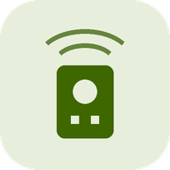
  <h1>Rimoat</h1>
  
<a href="#简体中文">简体中文</a> · <a href="#english">English</a>

---

## 简体中文

Rimoat 是一款 Android 红外遥控器应用，支持电视、空调、风扇、投影仪、机顶盒、功放等多种设备，允许学习红外信号，也支持外接红外头。

  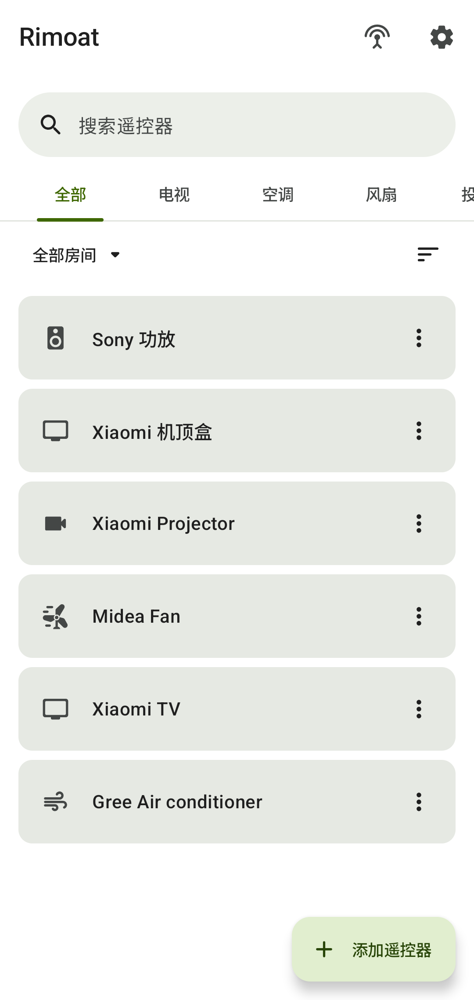
  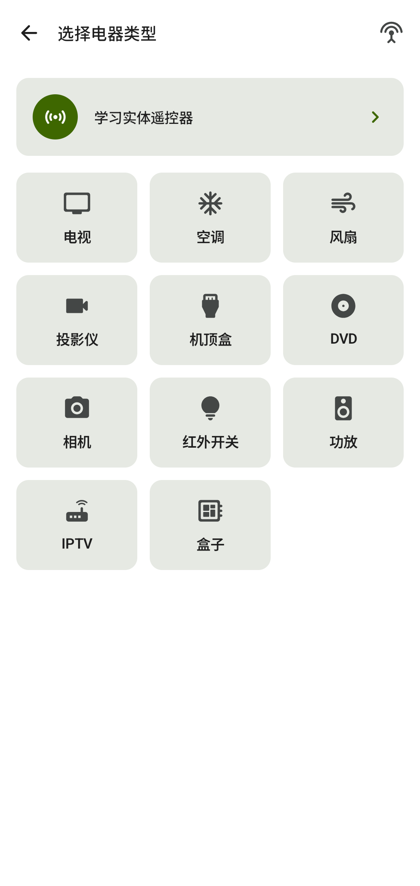
  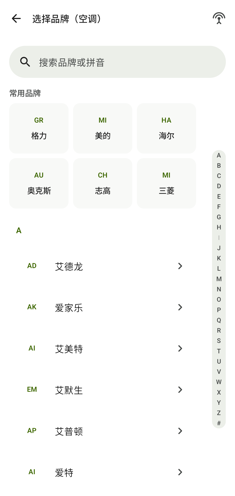
  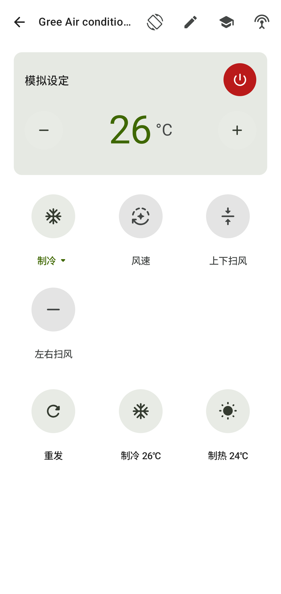
  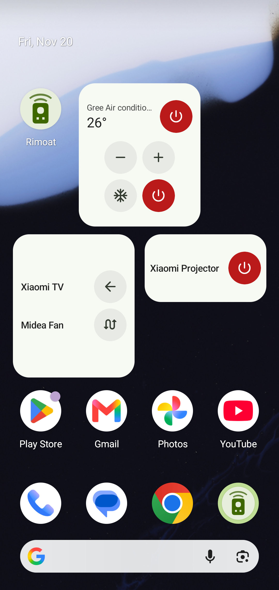

---

## English

Rimoat is an Android infrared remote controller app. It supports a wide range of appliances—including TVs, air conditioners, fans, projectors, set-top boxes, and amplifiers—allows learning IR signals, and supports external IR blasters.

  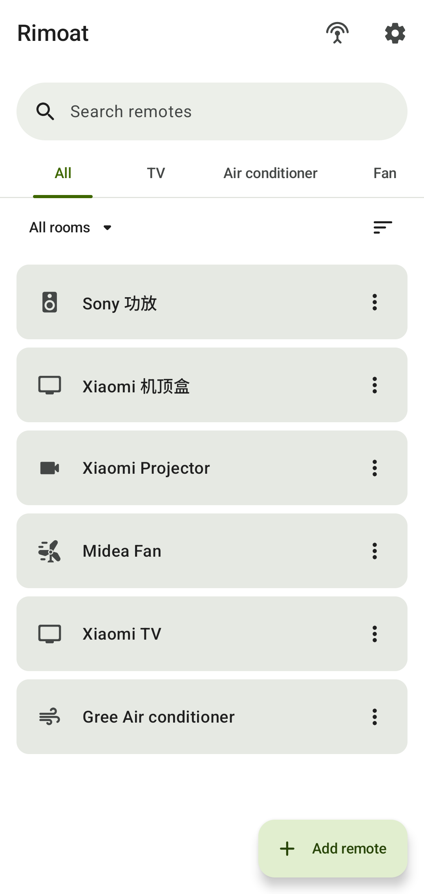
  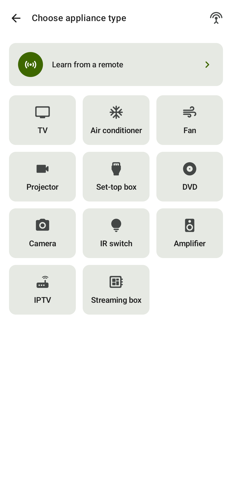
  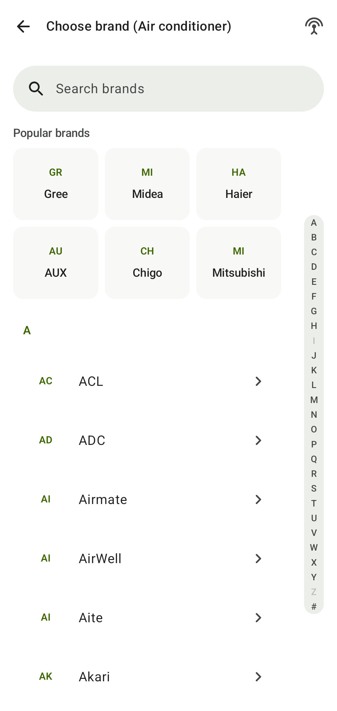
  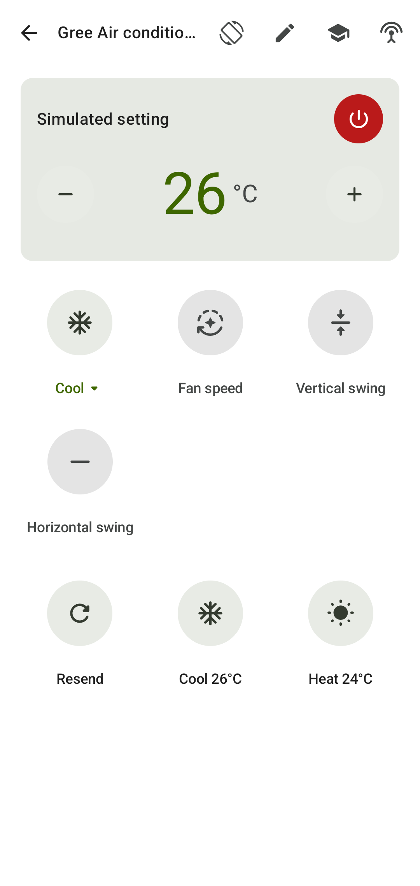
  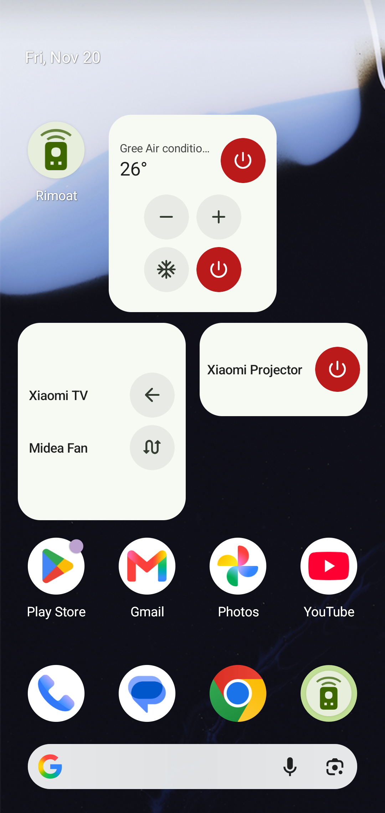

